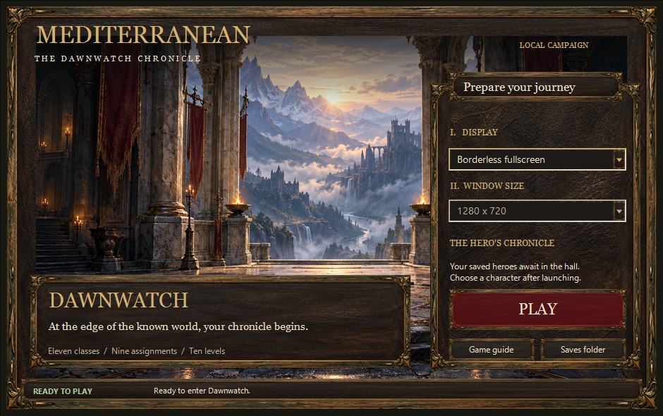
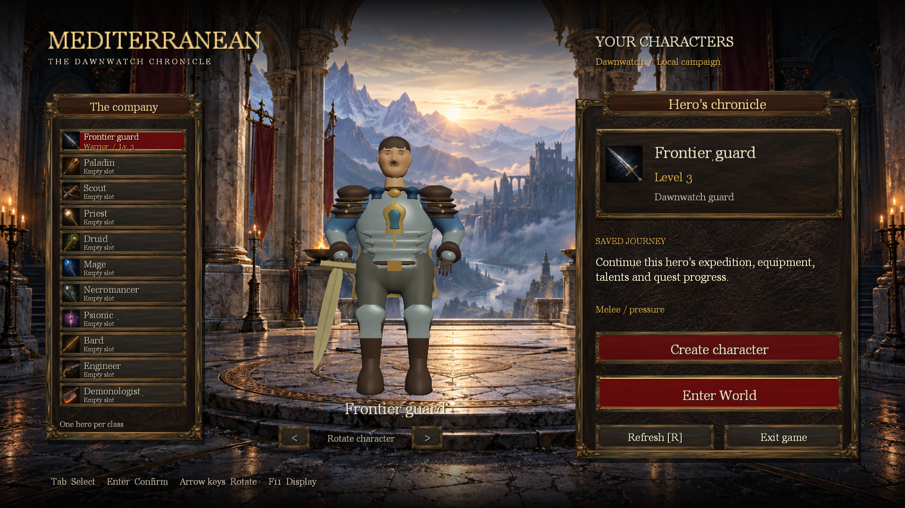
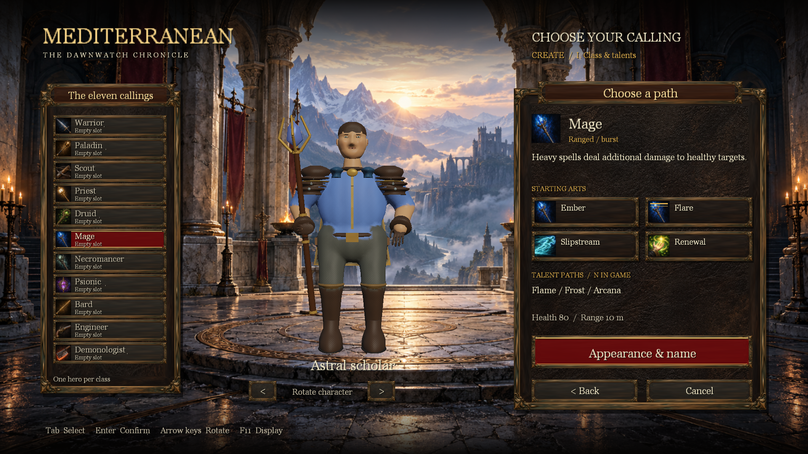
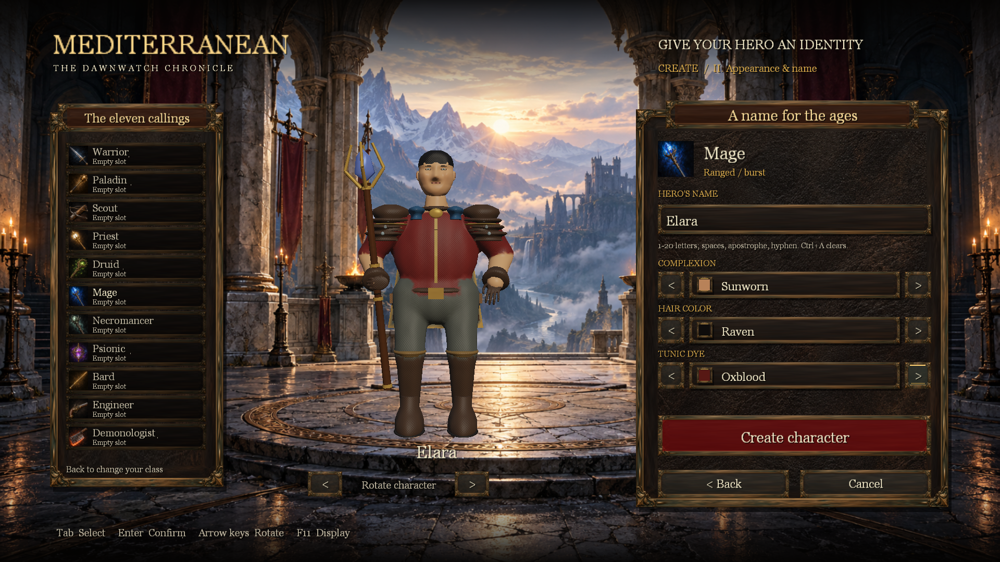
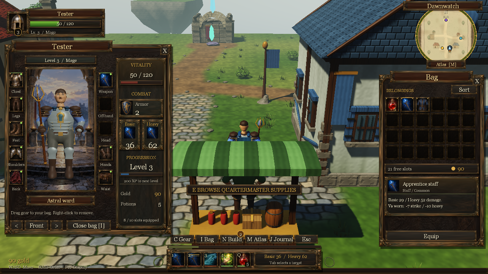

# Antique interface redesign - 2026-10-22

The old UI used flat green fills, repeated thin wire decoration and symbolic item drawings. That produced little sense of metal, leather or crafted depth. The supplied reference screenshot instead establishes dimensional framing, dense painted object detail and restrained dark panel interiors. This pass changes the actual visual resources and shared drawing path.

| Surface | Previous presentation | Implemented presentation |
| --- | --- | --- |
| Launcher | Thin ornamental lines around a small game capture | Shared carved bronze relief, worn leather, full chapter-hall artwork, burgundy Play action and skinned native dropdown borders/arrows |
| Character selection | Flat teal backdrop, rectangular curtain box, small hero | Scenic stone hall, enlarged live rotating hero, separate class ledger and hero chronicle, painted class weapon icons |
| Character and inventory | Flat panels and geometric equipment symbols | Sculpted material frames, recessed quiet empty cells, painted wearables/weapons and live item comparisons |
| Other game panels | Repeated green frames | Shared antique material system for Esc, talents, quests, journal, trade and atlas framing |
| HUD | Stylized guard drawing and symbolic abilities | Painted armor crest, illustrated equipment/spells, live level/threat/cooldown overlays |

These are captures from the built Release application, not design mockups. Text and controls remain live. The illustrated hall is a menu backdrop; it does not replace the playable map. The visible champion and world remain prototype 3D artwork and need a separate production art pass.

## Launcher

## Character selection

The follow-up separates the roster from class selection and appearance editing. These updated Release captures show the functional screens.

## Equipment interface

The [asset manifest](../assets/ui/README.md) records research links, generation prompts, provenance, icon layout and runtime memory. All three original assets were created with the built-in image-generation tool and saved in the repository. No external game textures or downloaded packs are included.

## Checks and remaining work

Full Debug and Release suites passed. Final UI checks exercise native startup, launcher preferences, all class slots, saved/new/bad-save states, input routing, equipment actions, cooldown behavior and DirectX diagnostics. Captures were inspected at small/normal/ultrawide game sizes and 100/150/200% launcher scaling. Texture accounting is checked against a combined 20 MiB cap.

The historical 3D models and world surfaces still need a dedicated art pass. Icons are illustrations, not exact renderings of current meshes; several class abilities still share motifs. Sustained interactive play, live dropdown keyboard use and mixed-monitor DPI transitions remain manual acceptance in checks 186-188.
